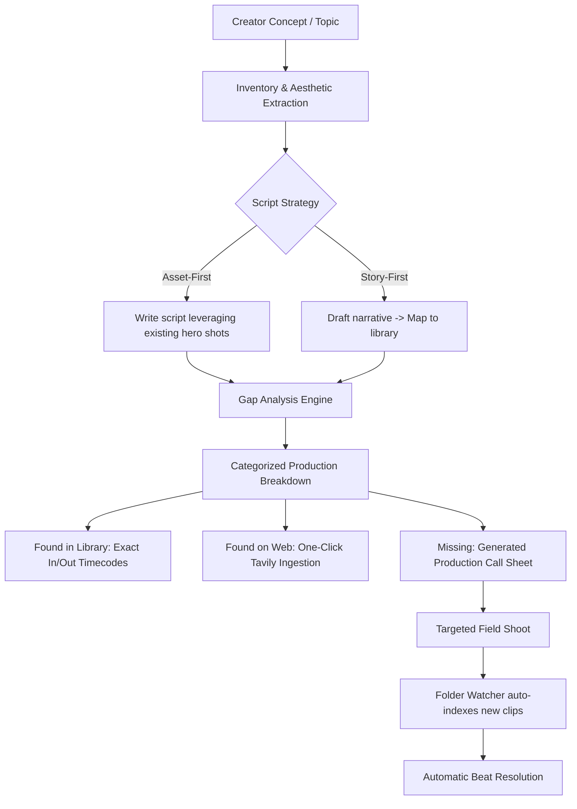
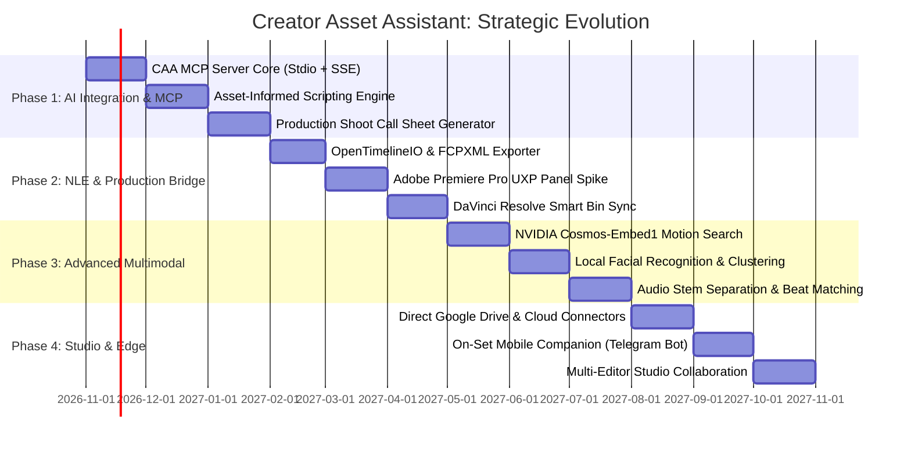

# Creator Asset Assistant: Strategic Future Roadmap & Implementation Plan

> **Document Status**: Strategic Technical Blueprint  
> **Target Version**: v1.0.0 – v3.0.0  
> **Core Focus**: Model Context Protocol (MCP) Ecosystem, Asset-Informed Script & Shoot Planning, NLE Integrations, and Autonomous Creative Intelligence.  
> **Related Documentation**: [README.md](file:///c:/soma/projects/content-creation-assistant/README.md) · [plan.md](file:///c:/soma/projects/content-creation-assistant/plan.md) · [docs/scenario-walkthrough.md](file:///c:/soma/projects/content-creation-assistant/docs/scenario-walkthrough.md) · [docs/tavily.md](file:///c:/soma/projects/content-creation-assistant/docs/tavily.md)

---

## 1. Executive Summary & Paradigm Shift

**Creator Asset Assistant (CAA)** currently provides private, local-first multimodal indexing and millisecond-level hybrid search across video shots, photos, sound effects, music, and design templates. It links local storage with cloud-backed NVIDIA Nemotron captioning and Tavily web intelligence.

### The Paradigm Shift: From Passive Retrieval to Asset-Informed Creation

Traditional AI video workflows suffer from a fundamental disconnect:

```
[ Traditional Generative AI Pipeline ]
Idea ──► AI Writes Script in Vacuum ──► Creator searches for 100 impossible b-roll shots
                                        ├── 70% missing ──► expensive reshoots / generic stock
                                        └── Existing footage on disk sits completely ignored
```

By introducing an **Asset-Aware Model Context Protocol (MCP) Server**, CAA flips this workflow:

```
[ CAA Asset-Informed Production Pipeline ]
Existing Library (Local + Drive)
  │ (SigLIP 2, Nemotron 3.5 Super VL, Parakeet transcripts, metadata)
  ▼
CAA MCP Server & Plugin
  │ (Exposes structured inventory, aesthetic profile, shot timecodes)
  ▼
Connected AI Models (Claude, ChatGPT, Antigravity, Cursor, Hermes Agent, Local LLMs)
  │
  ├─► 1. Asset-Anchored Scripting: Co-writes scripts designed around high-value footage you already have
  ├─► 2. Production Shoot Planner: Performs asset-gap analysis to generate a targeted call sheet & shoot list
  └─► 3. Rough Cut Generation: Auto-assembles FCPXML / OTIO timelines directly into Premiere / Resolve
```

This transforms CAA from an asset management index into the **central creative intelligence hub** for video creators, solo YouTubers, and production teams.

---

## 2. Flagship Implementation: The Model Context Protocol (MCP) Ecosystem

The **Model Context Protocol (MCP)** is an open standard that allows frontier AI models (such as Claude Desktop, OpenAI ChatGPT, Cursor, Antigravity, and autonomous agents) to securely discover and execute tools and read structured resources from local systems.

```
┌────────────────────────────────────────────────────────────────────────┐
│                   External / Client AI Environments                     │
│  Claude Desktop · Cursor · Antigravity IDE · ChatGPT · Hermes Agent    │
└───────────────────────────────────┬────────────────────────────────────┘
                                    │ Model Context Protocol (JSON-RPC)
                                    │ Transport: Stdio (CLI) or SSE/HTTP
                                    ▼
┌────────────────────────────────────────────────────────────────────────┐
│                       CAA MCP Server (`caa-mcp`)                       │
│  Location: engine/caa/mcp/ · Exposed on localhost:8765/mcp             │
├────────────────────────────────────────────────────────────────────────┤
│  [MCP Resources]                                                       │
│  - caa://library/summary        (Inventory breakdown, tags, styles)    │
│  - caa://assets/{id}            (Deep metadata, keyframes, transcript) │
│  - caa://shoots/active          (Current production shoot state)       │
├────────────────────────────────────────────────────────────────────────┤
│  [MCP Tools]                                                           │
│  - search_library               - inspect_shot_details                 │
│  - plan_script_from_assets      - generate_shoot_plan                  │
│  - assemble_roughcut_timeline   - find_asset_gaps                      │
│  - download_gap_fillers         - check_commercial_licences            │
├────────────────────────────────────────────────────────────────────────┤
│  [MCP Prompts]                                                         │
│  - asset_aware_script_writer    - production_call_sheet_generator      │
└───────────────────────────────────┬────────────────────────────────────┘
                                    │ Internal Python Service Calls
                                    ▼
┌────────────────────────────────────────────────────────────────────────┐
│                      Core Engine Services ([caa])                      │
│  [search.py](file:///c:/soma/projects/content-creation-assistant/engine/caa/search.py) · [db.py](file:///c:/soma/projects/content-creation-assistant/engine/caa/db.py) · [broll.py](file:///c:/soma/projects/content-creation-assistant/engine/caa/broll.py) · [indexer.py](file:///c:/soma/projects/content-creation-assistant/engine/caa/indexer.py) · [tavily.py](file:///c:/soma/projects/content-creation-assistant/engine/caa/tavily.py)   │
└────────────────────────────────────────────────────────────────────────┘
```

### 2.1 Server Architecture & Connection Modes

The CAA MCP server will support two primary connection modes:
1. **Stdio Subprocess (`caa mcp --stdio`)**:
   - Zero-configuration plug-in for desktop clients (Claude Desktop, Cursor, local agent runners).
   - Launched directly as a child process using the bundled Python virtual environment.
2. **Server-Sent Events (SSE) / HTTP (`http://127.0.0.1:8765/mcp`)**:
   - Integrated directly into [engine/caa/api.py](file:///c:/soma/projects/content-creation-assistant/engine/caa/api.py).
   - Allows network-aware agents and multiple local tools to tap into the active engine instance simultaneously.

### 2.2 Core MCP Tools Specification

#### Tool 1: `caa_get_library_inventory`
*Allows the AI model to understand the creator's creative capabilities before writing a single word.*
* **Input Schema**:
  ```json
  {
    "type": "object",
    "properties": {
      "kinds": {"type": "array", "items": {"type": "string", "enum": ["video", "image", "audio", "template"]}},
      "top_tags_limit": {"type": "integer", "default": 50},
      "include_locations": {"type": "boolean", "default": true},
      "include_date_ranges": {"type": "boolean", "default": true}
    }
  }
  ```
* **Output**: Summary of total footage hours, recurring camera bodies (e.g. Sony A7S III, DJI Mini 4 Pro, iPhone 16), GPS clusters (e.g. "Tokyo 2026", "Iceland Roadtrip", "Home Studio"), dominant mood tags ("cinematic", "cyberpunk", "warm sunset"), and audio genres available.

#### Tool 2: `caa_search_assets`
*Multimodal natural-language search with exact timecodes and visual confidence.*
* **Input Schema**:
  ```json
  {
    "type": "object",
    "properties": {
      "query": {"type": "string", "description": "Semantic query, visual description, or recording time"},
      "kind": {"type": "string", "enum": ["video", "image", "audio", "template"]},
      "min_duration": {"type": "number"},
      "max_duration": {"type": "number"},
      "orientation": {"type": "string", "enum": ["landscape", "portrait"]},
      "green_screen": {"type": "boolean"},
      "limit": {"type": "integer", "default": 5}
    },
    "required": ["query"]
  }
  ```
* **Output**: Top ranked asset segments with `asset_id`, `segment_id`, `in_point`, `out_point`, `timecode`, `caption`, `spoken_words`, and `filepath`.

#### Tool 3: `caa_plan_asset_informed_script`
*Takes a narrative premise and co-develops a script anchored to existing b-roll and sound design.*
* **Input Schema**:
  ```json
  {
    "type": "object",
    "properties": {
      "topic": {"type": "string", "description": "Core subject or premise"},
      "target_duration_seconds": {"type": "integer", "default": 60},
      "tone": {"type": "string", "description": "e.g., fast-paced tech review, documentary essay, energetic vlog"},
      "mandatory_assets": {"type": "array", "items": {"type": "integer"}, "description": "Specific asset IDs that must be featured"}
    },
    "required": ["topic"]
  }
  ```
* **Output**: Line-by-line script beats where each line has:
  - Spoken narration or dialogue.
  - Linked library footage (exact file path, start/end seconds, preview thumbnail URI).
  - Ambient sound or music recommendations from the local sound library.
  - Flagged gap indicators if a narrative beat lacks visual support.

#### Tool 4: `caa_generate_production_shoot_plan`
*Transforms a finalized script and asset audit into an actionable, location-grouped filming call sheet.*
* **Input Schema**:
  ```json
  {
    "type": "object",
    "properties": {
      "script_beats": {"type": "array", "description": "Script beats with marked asset gaps"},
      "available_gear": {"type": "array", "items": {"type": "string"}},
      "target_locations": {"type": "array", "items": {"type": "string"}}
    },
    "required": ["script_beats"]
  }
  ```
* **Output**: Complete production schedule (see [Section 3](#3-asset-informed-script--shoot-planning-engine) for schema).

#### Tool 5: `caa_export_roughcut`
*Converts planned beats into an industry-standard sequence file.*
* **Input Schema**:
  ```json
  {
    "type": "object",
    "properties": {
      "format": {"type": "string", "enum": ["fcpxml", "edl", "otio", "premiere_csv"]},
      "timeline_name": {"type": "string"},
      "beats": {"type": "array"}
    },
    "required": ["format", "beats"]
  }
  ```
* **Output**: XML/OTIO file ready to be dragged directly into DaVinci Resolve, Final Cut Pro, or Adobe Premiere Pro.

---

## 3. Asset-Informed Script & Shoot Planning Engine

### 3.1 The Two-Way Planning Lifecycle

Instead of treating footage collection and scriptwriting as separate stages, the planning engine creates a continuous feedback loop:



### 3.2 Deep Gap Analysis & The Production Shoot Call Sheet

When an AI model analyzes the script against the library, it categorizes every beat into three distinct tiers:

| Tier | Status | Action Taken |
|---|---|---|
| **Tier 1: Library Match** | High semantic/look match score ($\ge 0.72$) | In/Out timecode tagged; linked directly to local file. |
| **Tier 2: Stock Gap-Fillable** | Generic b-roll (e.g., "timelapse clouds", "keyboard typing") | Automatically searched via Tavily on Pexels/Pixabay/Mixkit; ready for one-click Save to Inbox. |
| **Tier 3: Custom Shoot Required** | Unique subject, creator on camera, specific product/location | Routed into the **Smart Shoot Plan**. |

#### Concrete Output: Production Shoot Plan Structure
The MCP tool generates a structured production call sheet grouped by **Location & Setup Efficiency** rather than chronological script order:

```markdown
# Production Shoot Plan: "Building a Private AI Studio"
Target Video Duration: 180s | Estimated Shoot Time: 2h 15m
Footage Reused from Library: 68% (122s) | New Shots Needed: 32% (58s)

## Location 1: Home Office / Desk Setup
*Lighting: High key, Key light 5600K at 45° | Audio: Lav mic + Studio ambience*

- [ ] **Shot S-01 (Beat 03)**: Macro close-up of fingers typing on mechanical keyboard.
      *Specs*: 60 fps, 85mm f/2.0, Shallow DOF, push-in.
      *Why*: Existing keyboard shots in library are wide; script demands intimate focus.
- [ ] **Shot S-02 (Beat 07)**: Over-the-shoulder shot looking at terminal showing local model inference.
      *Specs*: 24 fps, 35mm f/2.8, slow tilt down.
      *Note*: Replace with screen recording if glare is excessive.

## Location 2: Outdoor / Terrace (Golden Hour ~5:45 PM)
*Gear: Gimbal, ND 16 filter, 24-70mm lens*

- [ ] **Shot S-03 (Beat 11)**: Medium tracking shot walking toward camera explaining privacy architecture.
      *Specs*: 24 fps, 35mm f/4.0.
      *Context*: Pairs with `DJI_0049_D.MP4` (airplane clouds already in library).
```

---

## 4. Non-Linear Editor (NLE) Integrations

While modern video creators use standalone apps for research, their primary work environment is the NLE timeline. CAA will bridge directly into editing suites.

```
┌─────────────────────────────────────────────────────────────┐
│                 Creator Asset Assistant Engine               │
│                 (Local Server on 127.0.0.1:8765)            │
└──────────────┬──────────────────────────────┬───────────────┘
               │                              │
               ▼                              ▼
 ┌───────────────────────────┐  ┌───────────────────────────┐
 │ Adobe Premiere Pro Panel  │  │  DaVinci Resolve Studio   │
 │   - UXP / CEP Technology  │  │   - Python Workflow Script│
 │   - Dockable Native Panel │  │   - Media Pool Sync       │
 │   - Drag-to-Sequence      │  │   - Smart Bin Generation  │
 └───────────────────────────┘  └───────────────────────────┘
```

### 4.1 Adobe Premiere Pro UXP Panel
* **Technology**: Modern Adobe Unified Extensibility Platform (UXP) using HTML/CSS/JS.
* **Features**:
  - Docked directly alongside the Media Browser and Effect Controls.
  - Instant text and time-based search pulling from the local engine's `/api/search`.
  - **Match Playhead Context**: Click a button to read the current playhead timecode, transcription of current audio track, and instantly query CAA for matching b-roll cutaways.
  - **Native Drag-and-Drop**: Drag a search result card straight into Premiere's Project Bin or directly onto a video track (V2/V3) with in/out points pre-trimmed.

### 4.2 DaVinci Resolve Workflow Integration
* **Technology**: DaVinci Resolve Python 3 API (`DaVinciResolveScript`).
* **Features**:
  - **Auto-Smart Bins**: Sync CAA's semantic tags into DaVinci Smart Bins (`@drone`, `@greenscreen`, `@high_energy_audio`, `@interviews`).
  - **Script-to-Timeline Importer**: Run an automation script that reads a CAA B-roll plan JSON and lays out a multi-track rough cut timeline with markers indicating beat lines and notes.

### 4.3 OpenTimelineIO (OTIO) & FCPXML Exporter
* Standalone universal format support:
  - Generate `.otio` (Pixar OpenTimelineIO) and `.fcpxml` (Final Cut Pro XML, also supported natively by CapCut and Resolve).
  - Users click **"Export Timeline"** on any B-roll plan to generate a project file that opens with all local media linked at exact sub-second cut points.

---

## 5. Proactive Multimodal Agents & Contextual Timeline Copilot

### 5.1 The Hermes Agent & OpenShell Sandbox Architecture
Building on the foundation laid out in [plan.md](file:///c:/soma/projects/content-creation-assistant/plan.md#L129-L132):
* **Sandboxed Runtime**: Hermes Agent runs inside an OpenShell container (via WSL 2 on Windows or Docker).
* **Strict Egress Whitelist**: Asset paths are mounted read-only; write permissions are restricted exclusively to the `Videos\CreatorAssets\Inbox` folder and Hermes's persistent state.
* **Autonomous Skill Writing (`SKILL.md`)**:
  - Hermes observes the user's accept/reject actions from [engine/caa/api.py](file:///c:/soma/projects/content-creation-assistant/engine/caa/api.py#L174-L180).
  - When a creator repeatedly rejects sound effects over 1.0 second or prefers vertical drone clips for tech beats, Hermes synthesizes a new skill markdown file (e.g. `skills/jump-cut-sfx.md`).
  - The next MCP tool invocation or suggestion automatically injects this skill rule.

### 5.2 The "Timeline Listener" (Proactive Suggestion Engine)
* Rather than requiring manual search typing, an optional background listener monitors editor activity:
  - **Trigger A (Silence / Audio Gap)**: Voiceover pauses for $\gt 1.5\text{s}$ $\rightarrow$ Proactively surface subtle ambient whooshes or riser transitions.
  - **Trigger B (Extended Talking Head)**: A single video clip runs for $\gt 6\text{s}$ without cutaways $\rightarrow$ Surface top 3 semantic b-roll matches for the exact words spoken in that window.
  - **Trigger C (Green Screen Placement)**: A green screen clip is dragged in $\rightarrow$ Suggest matching scenic backgrounds from the photo/video library.

### 5.3 On-Set Mobile Companion ("Telegram / WhatsApp Field Assistant")
* Solo creators on location frequently wonder: *"Did I already get a good shot of the entrance, or do I need to film it again?"*
* **Mobile Bot Bridge**:
  - Connects to the desktop engine via secure ngrok / Cloudflare Tunnel / Tailscale mesh.
  - The creator sends a quick voice note or text: *"Show me all shots of the hotel lobby"*.
  - CAA runs a look + meaning search and sends back 3 low-res video keyframe GIFs with recording dates.
  - The creator immediately knows whether they can move on or must set up a tripod.

---

## 6. Advanced Multimodal AI & Local Engine Roadmap

### 6.1 Temporal Motion-Aware Video Search (NVIDIA Cosmos-Embed1)
* **Current Implementation**: [engine/caa/indexer.py](file:///c:/soma/projects/content-creation-assistant/engine/caa/indexer.py) extracts 3 static keyframes per shot and averages their 2D SigLIP 2 embeddings.
* **Limitation**: Cannot distinguish between camera movements (e.g., a "slow cinematic pan right" vs. "fast whip pan left" vs. "static tripod shot").
* **Future Upgrade**:
  - Incorporate **NVIDIA Cosmos-Embed1** (a native video-text embedding model processing 8-16 temporal frames simultaneously).
  - Enables searches specifically targeting motion aesthetics:
    - `"drone slow descending pedestal shot"`
    - `"handheld running POV"`
    - `"fast 360 orbit around subject"`

### 6.2 Facial Recognition & Recurring Subject Clustering
* **Problem**: Creators search for people: *"Find clips where Sarah is laughing"*, *"B-roll of Dave soldering"*.
* **Solution**:
  - Integrate an ultra-lightweight on-device face detector (InsightFace / SCRFD) during the indexing pass.
  - Group facial embeddings into local clusters without cloud uploads.
  - Allow the user to tag a cluster once ("Sarah"), enabling instant queries like: `"Sarah + outdoor golden hour + smiling"`.

### 6.3 Local Audio Stem Separation & Beat-Sync Analysis
* **Technology**: Meta Demucs or ONNX-optimized stem splitter.
* **Capabilities**:
  - Automatically separate voiceover from background music in ingested camera footage.
  - Index clean speech even in noisy outdoor environments.
  - Extract musical transients, beat grids, and BPM from the music library:
    - Automatically suggest cut points aligned to downbeats.
    - Match b-roll pacing to music track tempo.

### 6.4 Offline Nemotron via Local RTX NIM / Ollama
* For creators with NVIDIA GeForce RTX GPUs (RTX 3060/4070/4090):
  - Provide an opt-in toggle to run **Nemotron 3 Nano / Super** locally via Ollama or local NIM container.
  - Switches CAA into **True Zero-Egress Offline Mode**, captioning and reasoning entirely on the user's graphics card without calling Nebius Token Factory.

---

## 7. Cloud Sync, Studio Collaboration & Production Ingest

| Component | Target Capability | Implementation Approach |
|---|---|---|
| **Google Drive API (Direct)** | Native cloud library indexing without streaming local disk lag | Google Picker API + selective cloud thumbnail fetching; full download only on demand |
| **Dropbox & Frame.io Sync** | Ingest review clips and client feedback comments directly as search metadata | Webhook listener to auto-index new uploads into project folders |
| **Auto-SD Card Ingest Station** | Automatic offload upon card insertion | Hardware volume watcher detects camera cards (`DCIM/`), copies with checksum verification, generates fast 720p proxies, and starts instant indexing |
| **Studio Shared Library** | Multi-editor teams sharing a central NAS / SAN | Centralized PostgreSQL or replicated SQLite WAL; read-only team permissions with individual feedback memory |

---

## 8. Licencing, Monetization & Pre-Publish Shield

Building upon the Tavily licence engine in [engine/caa/sources.py](file:///c:/soma/projects/content-creation-assistant/engine/caa/sources.py):

```
┌─────────────────────────────────────────────────────────────────┐
│                 Pre-Publish Compliance Guard                    │
├─────────────────────────────────────────────────────────────────┤
│ [Active Timeline Asset Audit]                                   │
│  ├─ Clip 01: Pexels (Free commercial, No credit)       [PASS]   │
│  ├─ Clip 02: BBC Sound Effects Archive                 [ALERT]  │
│  │   └─ WARNING: Non-commercial RemArc licence.                 │
│  │      Monetized YouTube upload risks copyright strike!        │
│  ├─ Clip 03: Freesound (CC-BY 4.0 Attribution)         [ACTION] │
│  │   └─ Credit required. Auto-added to description block.       │
├─────────────────────────────────────────────────────────────────┤
│ [1-Click Action]                                                │
│  [ Copy Ready-to-Paste YouTube Video Description Credits Block ] │
└─────────────────────────────────────────────────────────────────┘
```

1. **YouTube Content ID Pre-Check**:
   - Compare ingested audio and music tracks against known copyright databases.
   - Alert the editor before export if a track will trigger a demonetization claim.
2. **Dynamic Licence Expiry Monitoring**:
   - Scheduled background task checks free asset source pages every 30 days via Tavily.
   - Flags if an asset was taken down or had its terms retroactively altered by the distributor.

---

## 9. Phased Implementation Roadmap



### Phase 1: AI Integration & MCP Core (Months 1–3)
- [ ] Implement `engine/caa/mcp/` server implementing the Model Context Protocol specifications.
- [ ] Expose tools for `get_library_inventory`, `search_assets`, and `inspect_shot_details`.
- [ ] Build the `Asset-Informed Script & Shoot Planner` module extending [engine/caa/broll.py](file:///c:/soma/projects/content-creation-assistant/engine/caa/broll.py).
- [ ] Create official MCP configuration presets for Claude Desktop, Cursor, and Antigravity.

### Phase 2: NLE & Production Workflow Bridge (Months 4–6)
- [ ] Implement universal timeline export (`.fcpxml`, `.otio`) from planned script beats.
- [ ] Build Premiere Pro UXP dockable extension interfacing with `127.0.0.1:8765`.
- [ ] Develop DaVinci Resolve Python helper script to populate Media Pool bins with indexed tags.
- [ ] Add pre-publish commercial licence validator and credit block generator.

### Phase 3: Advanced Multimodal Intelligence (Months 7–9)
- [ ] Integrate NVIDIA Cosmos-Embed1 for motion-aware temporal video retrieval.
- [ ] Add local on-device face detection and character clustering.
- [ ] Demucs audio stem separation and BPM/transient beat-sync cut points.
- [ ] Local RTX NIM offline mode support via Ollama for users with high-end GPUs.

### Phase 4: Studio, Cloud & Mobile Ecosystem (Months 10–12)
- [ ] Native Google Drive API connector with Picker support.
- [ ] Auto-ingest station for camera SD cards with background proxy generation.
- [ ] Telegram/WhatsApp mobile bot for on-set field inquiries.
- [ ] Multi-seat studio database replication for small production houses.

---

## 10. Summary of Architectural Impact

By executing this future plan, **Creator Asset Assistant** evolves from a powerful local search engine into an **end-to-end Creative Intelligence Platform**:
* **For the Creator**: Eliminates dozens of wasted hours searching folders, prevents expensive redundant reshoots, and guarantees commercial licence safety.
* **For AI Models**: Gives LLMs and generative agents real-world eyes and ears into what assets actually exist on disk, grounding AI-generated scripts in reality.
* **For the Ecosystem**: Demonstrates the gold standard of private, local-first multimodal AI combining local open models (SigLIP 2, Parakeet) with cutting-edge NVIDIA Nemotron cloud intelligence and open MCP interoperability.
